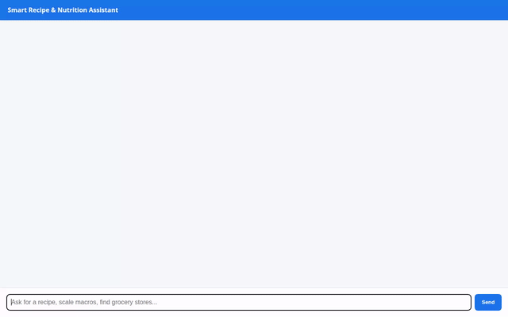

# Smart Recipe Assistant 🍳🤖

An AI-powered recipe and nutrition assistant built with the **Agent Development Kit (ADK)** and deployed on **Google Cloud Agent Runtime**. It helps users discover personalized recipes, remember long-term dietary restrictions and allergies, calculate precise nutritional macros, generate high-quality AI recipe photos & videos, and render rich interactive UI cards using **A2UI**.



---

## ✨ Features & Capabilities

The following features are directly implemented in `app/` and verified on Google Cloud:

- **🧠 Vertex AI Memory Bank**: Integrates `PreloadMemoryTool` and `VertexAiMemoryBankService` to persist long-term user memories (allergies, dietary preferences, personal health goals) across separate chat sessions.
- **🗄️ Firestore Recipe Storage**: Direct integration with Google Cloud Firestore (`recipes` collection) for storing, querying, and retrieving recipe collections (`search_recipes`, `save_recipe`).
- **🎨 AI Image Generation (Imagen 3)**: Generates high-resolution food presentation photography using Vertex AI `imagen-3.0-generate-002`. Images are saved as ADK Playground artifacts and uploaded to a public Google Cloud Storage bucket (`generate_recipe_image`).
- **📹 AI Video Generation (Gemini Omni)**: Generates short video demonstrations of recipes using Google's `gemini-omni-flash-preview` model in the `global` region (`generate_recipe_video`).
- **🌐 Web Recipe Retrieval**: Fetches and parses online recipe details and dietary info using web search (`fetch_online_recipe`).
- **⚡ Code Sandbox Executions**: Performs precise serving size adjustments and calorie macro calculations in an isolated `AgentEngineSandboxCodeExecutor` Python environment.
- **🖼️ Rich A2UI Interface**: Uses `A2uiSchemaManager` (v0.8) and `BasicCatalog` to emit structured visual UI cards (`a2ui_callback`), displaying recipe cards, nutrition tables, and generated images natively in the UI.
- **🔌 A2A Proxy & Chat UI**: Includes a minimal FastAPI proxy (`frontend/main.py`) communicating with the deployed agent over the Agent-to-Agent (A2A) protocol.

---

## 🛠️ System Architecture & Stack

- **Agent Framework**: Google ADK (Agent Development Kit) & `agents-cli` v1.1.0
- **LLM Engine**: `gemini-flash-latest` (Vertex AI)
- **Deployment Target**: Vertex AI Reasoning Engine (Agent Runtime)
- **Database**: Google Cloud Firestore
- **Storage**: Google Cloud Storage (Public media bucket)
- **Memory Service**: Vertex AI Memory Bank Service
- **UI Render Engine**: A2UI Schema Manager (v0.8) + FastAPI A2A Proxy

---

## 🚀 Setup & Local Execution

### 1. Prerequisites & Environment Setup

Ensure Python 3.11+ and Google Cloud SDK (`gcloud`) are installed and authenticated:

```bash
# Authenticate with Google Cloud
gcloud auth login
gcloud auth application-default login

# Install Python dependencies
pip install -r requirements.txt
```

### 2. Running the ADK Local Playground

To run the agent locally with live Memory Bank support:

```bash
uv run adk web . --port 8080 --reload_agents --memory_service_uri=agentengine://<MEMORY_BANK_ID>
```

### 3. Running the FastAPI Proxy & Web Frontend

To launch the standalone chat UI proxy locally:

```bash
# Set environment variables from your deployment metadata
export AGENT_ENGINE_RESOURCE_NAME="projects/<PROJECT_ID>/locations/<LOCATION>/reasoningEngines/<ENGINE_ID>"
export AGENT_DIRECTORY="app"

# Start the proxy server
cd frontend
python main.py
```

---

## ☁️ Deployment

Deploy the agent to Vertex AI Agent Runtime using `agents-cli`:

```bash
agents-cli deploy agent_runtime \
  --project <PROJECT_ID> \
  --region us-east1 \
  --update-env-vars GOOGLE_MAPS_API_KEY=<API_KEY>
```

### Service Account Roles

Ensure your deployed agent's service account has the following IAM roles:
- `roles/datastore.user` (for Firestore access)
- `roles/storage.objectAdmin` (for Cloud Storage media uploads)
